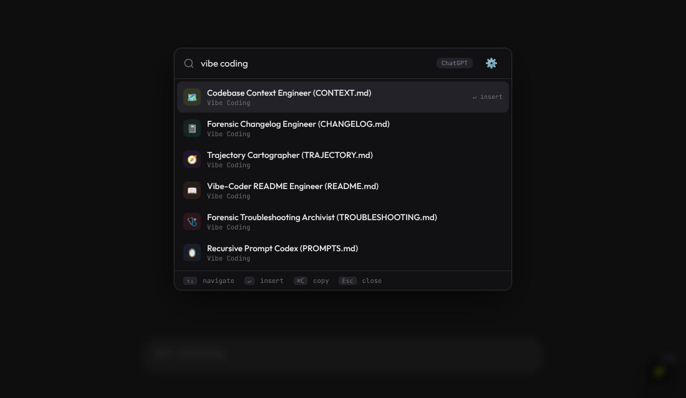
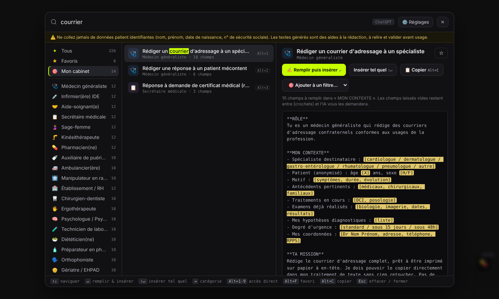
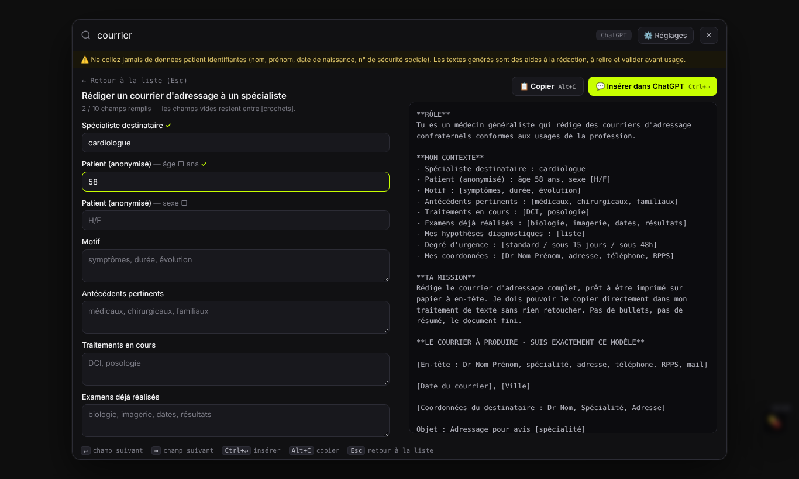

# Prompt Genius

> Press `Ctrl+Shift+P` on ChatGPT, Claude, Gemini (and 9 other AI sites) and paste any of your saved prompts in two keystrokes.

## What it is

A userscript: a small piece of JavaScript your browser runs on the AI chat sites you visit. It adds a search box on top of the chat. Type a few letters, press Enter, and the full prompt lands in the chat input, ready to send.

It comes as three separate userscripts. Install only the ones you want; they run side by side, each with its own shortcut and button:

| Userscript | Shortcut | What's inside |
|---|---|---|
| **[General](https://github.com/achma-learning/prompt-genius/raw/refs/heads/main/userscripts/general.user.js)** | `Ctrl+Shift+P` / `⌘⇧P` | 16 everyday prompts (thinking coaches, the Feynman technique, negotiation, photo restoration for Google Labs Flow…) **plus your own, loaded from your GitHub fork** |
| **[Vibe Coding](https://github.com/achma-learning/prompt-genius/raw/refs/heads/main/userscripts/vibe-coding.user.js)** | `Alt+V` / `⌥V` | the 6 Vibe Coding 101 prompts (CONTEXT.md, CHANGELOG.md…), a RELEASE prompt, plus 8 everyday helpers for coding with AI |
| **[Médical](https://github.com/achma-learning/prompt-genius/raw/refs/heads/main/userscripts/medical.user.js)** | `Alt+M` / `⌥M` | 226 French prompts for 21 health jobs |

You can add your own prompts, and they stay in your browser. No account, no server, no tracking, nothing to build.

## Install (step by step, no coding needed)

You do this once. It takes about 3 minutes.

### 1. Install a userscript manager

A userscript manager is a browser extension that runs userscripts. Pick one:

| Browser | Extension |
|---|---|
| Chrome / Brave / Edge / Opera | [Tampermonkey](https://www.tampermonkey.net/) or [Violentmonkey](https://violentmonkey.github.io/) |
| Firefox | [Tampermonkey](https://addons.mozilla.org/firefox/addon/tampermonkey/) or [Violentmonkey](https://addons.mozilla.org/firefox/addon/violentmonkey/) |
| Safari | [Userscripts](https://apps.apple.com/app/userscripts/id1463298887) |

Click **Add to browser** and accept.

### 2. Let the extension run scripts (Chrome, Edge, Brave and Opera only)

Chrome-based browsers block userscripts until you allow them. Do both steps below; they're harmless:

1. **Turn on Developer mode.** Paste `chrome://extensions` in the address bar (`edge://extensions` on Edge) and press Enter. Switch on **Developer mode** in the top-right corner.
2. **Allow user scripts.** On the same page, find Tampermonkey (or Violentmonkey) and click **Details**. Switch on **Allow User Scripts**. Recent Chrome versions (138+) need this; if you don't see the switch, step 1 is enough.

Firefox and Safari users can skip this step.

### 3. Install Prompt Genius

Click a script's link in the table above. Your userscript manager opens a page with an **Install** button. Click it. Each script updates itself from this repository.

**Already using the original all-in-one script?** It still works and stays available: [Greasy Fork](https://update.greasyfork.org/scripts/571159/Prompt%20Genius%20%E2%80%94%20AI%20Prompt%20Injector.user.js) or [GitHub](https://github.com/achma-learning/prompt-genius/raw/refs/heads/main/Prompt%20generator.user.js). It holds the General prompts plus the first six vibe coding prompts. Don't run it together with **General**: both use `Ctrl+Shift+P`. Disable it in your userscript manager once you've switched.

### 4. Check it works

Open [chatgpt.com](https://chatgpt.com) (or reload it if it was already open). A small button should appear in the bottom-right corner: **P** for General, **V** for Vibe Coding, 💊 for Médical. If it doesn't, go back to step 2.

## Usage

1. On any supported site, press **`Ctrl+Shift+P`** (Mac: **`⌘⇧P`**), or click the **P** button in the bottom-right corner.
2. Type to search, e.g. `feynman`.
3. Press **Enter**. The whole prompt appears in the chat box. Add your topic and send.

| Key | Does |
|---|---|
| `↑` `↓` | move through the list |
| `Enter` | insert the prompt into the chat |
| `Ctrl+C` / `⌘C` | copy the prompt instead |
| `Esc` | close |

**Your own prompts:** open the palette and click ⚙️. You can add a prompt, delete one, or import a `.json`, `.csv`, `.txt` or `.md` file. Export saves everything to a JSON file for backup.

**Your prompts from GitHub (General script):** keep your prompts in your own repository instead of in one browser.
1. [Fork this repo](https://github.com/achma-learning/prompt-genius/fork).
2. Put one prompt per `.md` or `.txt` file in the fork's [`all_prompts/`](./all_prompts) folder. The first `# heading` becomes the title, and sub-folders become categories. A `.json` file can also hold a list of prompts.
3. Enter `your-name/prompt-genius` in the window that appears once after install, or later under ⚙️ → **GitHub prompts…**. You can also paste the folder's URL.

Edits to the repo show up everywhere within 6 hours, or right away with **Load my prompts**. Only public repos work, and the script only reads from GitHub.

If `Ctrl+Shift+P` does something else in your browser (on Firefox it opens a private window), just click the **P** button.

**Works on:** ChatGPT, Claude, Gemini, Google Labs (Flow, Whisk, ImageFX), DeepSeek, Perplexity, Mistral, Grok, Copilot, You.com, Poe.

## Vibe Coding: your project's memory in plain files

The Vibe Coding script (`Alt+V`) keeps the simple **Vibe Coding 101** system. Paste a prompt into your AI coding assistant (Claude Code, Codex, Cursor, Antigravity…) with your repo open, and it writes or updates one file:

| File | What it holds |
|---|---|
| `CONTEXT.md` | the **present**, and the one real context file: what the project is, how to run it, the code map, rules, landmines, current state. If `CLAUDE.md`, `AGENTS.md` or `GEMINI.md` exist, it gathers what's in them and adds a line to each telling the AI to read and update CONTEXT.md |
| `CHANGELOG.md` | the **past**: the complete history of what changed and why, decoded from git history and never trimmed, so humans and AI agents can troubleshoot |
| `TRAJECTORY.md` | the **future**: the final goal plus a to-do list (now / next / later / done / won't do), built from your requests and the repo's GitHub issues |
| `README.md` | the page for humans |
| `TROUBLESHOOTING.md` | every bug already fixed, searchable by its exact error |
| `PROMPTS.md` | the prompts that built the repo |
| `RELEASE.md` | what users can install: current versions, git tags, GitHub Releases, how to roll back |

The CHANGELOG prompt also has a **Rescue** mode: say "everything is broken" or "it worked before", and it finds the commit that broke it with `git bisect`, starting from the last version marked ✅ known good.

Below them are **helpers** for everyday coding: Stabilize a Prototype (turn an AI-drafted prototype into a documented baseline), Plan Before Code, Debug, Review the Diff, Refactor Safely, Security Check, Manager (several agents at once, one file per agent) and Handoff (summarizes the chat into `HANDOFF.md`). Each one reads `CONTEXT.md` and ends by updating `CONTEXT.md` and `CHANGELOG.md`. They create no other files.

**Several prompts at once:** press `Tab` on each prompt you want (✓), then `Enter`. They're inserted as one numbered session, in list order.

## No install? Just copy

Download [`index.html`](./index.html) and open it in any browser. It's the same prompt library as a web page. Press `Ctrl+K` to search, and click the copy icon on any card.

The **Vibe Coding 101** section at the top has six prompts, in order, each with a one-click copy button. Paste them into your AI coding assistant (Claude Code, Cursor, Copilot…) with your repo open, and each one writes one file:

1. `CONTEXT.md`: what the project is, for the next AI that opens it
2. `CHANGELOG.md`: what changed and why, decoded from your git history
3. `TRAJECTORY.md`: decisions taken, ideas killed, so AI stops re-suggesting them
4. `README.md`: the page you're reading (made with prompt #4)
5. `TROUBLESHOOTING.md`: every bug you already fixed, searchable by its exact error message
6. `PROMPTS.md`: the prompts that built the repo

The full-length versions live in [`vibe-coding-tools-101/`](./vibe-coding-tools-101), and the helpers in [`vibe-coding-tools-101/helpers/`](./vibe-coding-tools-101/helpers/README.md).

## Médical: 226 prompts for health workers (in French)

A separate userscript: **[Install Prompt Genius — Médical](https://github.com/achma-learning/prompt-genius/raw/refs/heads/main/userscripts/medical.user.js)**. It installs the same way as above (steps 1 and 2 still apply). If you installed it before it moved to `userscripts/`, install it once more from this link; your saved prompts and settings stay. It holds 226 French prompts for 21 health jobs (GP, nurse, midwife, pharmacist, physio, lab tech, care home…), from the Lonasanté catalogue « 226 Prompts IA Santé ».

1. Press **`Alt+M`** (Mac: **`⌥M`**), or click the 💊 button. It runs side by side with the other scripts; each has its own shortcut.
2. Type without accents (`medecin`, `ordonnance`), or pick your job on the left. `Tab` moves between categories.
3. Press **Enter**. A form opens with one field per `[bracket]` of the prompt's « MON CONTEXTE » block. `Enter` jumps to the next field, and **`Ctrl+Enter`** inserts the filled prompt after whatever you had already typed. `Shift+Enter` inserts the prompt as it is.

**⚙️ Réglages** (settings) has four tabs:
- **🎯 Mes filtres:** pick your job, add the prompts you use from other jobs, and you get your own category, opened by default if you want. For example, a GP's « Mon cabinet » can be « Médecin généraliste » plus three prompts from « Secrétaire médicale ». While browsing, the preview's « Ajouter à un filtre » menu does the same.
- **Prompts actifs:** switch off whole jobs or single prompts you never use. They leave the palette and the search, so both get lighter.
- **Mes prompts:** add, import (JSON, CSV with `,` or `;`, TXT, MD) or export your own prompts.
- **Préférences:** shortcut, floating button, preview pane, and remembering your answers (off by default).

Also: `Alt+F` favourite, `Alt+C` copy, `Alt+1`–`9` jump to a result, and a « Récents » list.

The landing page has the same 226 prompts in a « Prompts médicaux » section, with copy buttons. Never paste identifying patient data into an AI chat.

## What's new

**Médical v3.1.0** rebuilds the medical palette for desktop. It adds a three-pane layout, custom filters (« Mes filtres »), on/off switches for prompts, accent-free search and favourites. It also fixes 15 bugs, including a clash with the main script, the last 26 prompts being unreachable, and wrong form filling. The landing page gained the medical section. [Full changelog →](./CHANGELOG.md)

## Releases & older versions

[`RELEASE.md`](./RELEASE.md) lists the current version of each script, with a link to install exactly that version, and how to roll back. Every release is also on the [Releases page](https://github.com/achma-learning/prompt-genius/releases). Rolling back? Turn off "Check for updates" for that script, or your userscript manager updates it again.

## Also in this repo

- [`all_prompts/`](./all_prompts) holds older prompts in plain text, waiting to be promoted into the palette.

## Why I built this

I take prompts I find useful and keep a backup copy here. Then I kept forgetting where I'd put them and retyping them from memory, so I made them one shortcut away on whatever AI site I'm using.

Good place to find more prompts:
[My top 10 most popular ChatGPT prompts (2M+ views)](https://old.reddit.com/r/ChatGPTPromptGenius/comments/1kfzq6c/my_top_10_most_popular_chatgpt_prompts_2m_views/).

## License

MIT. See [`LICENSE`](./LICENSE).

## See also

- [`CONTEXT.md`](./CONTEXT.md) is for AI assistants joining the project
- [`TRAJECTORY.md`](./TRAJECTORY.md) is the project's final goal and to-do list
- [`CHANGELOG.md`](./CHANGELOG.md) lists what shipped when
