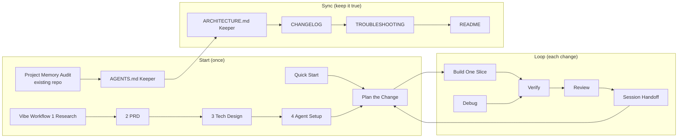

# The vibe coding prompt system

`userscripts/vibe-coding.user.js` (⌥V / Alt+V) holds 30 prompts that work as one system instead of a pile of overlapping prompts. This page explains the design so you can judge it, extend it, or run it by hand.

## One rule: one question per file, one owner per file

The project's memory lives in five core files. Each one answers exactly one question. Any other file that needs a fact **links** to the file that owns it and never copies it. It's the same idea as database normalization: a fact stored twice will drift.

| File | Answers only | Created by | Kept true by |
|---|---|---|---|
| `AGENTS.md` | How must any AI work here? (commands, code rules, don'ts, landmines) | Quick Start / Vibe Workflow 4 | AGENTS.md Keeper |
| `docs/PRD.md` | What are we building, for whom, and when is it done? | Quick Start / Vibe Workflow 2 | (changes only when scope changes) |
| `docs/ARCHITECTURE.md` | How is it built and why? (stack, structure, data model, decisions, operations) | Quick Start / Vibe Workflow 3 | ARCHITECTURE.md Keeper |
| `MEMORY.md` | Where are we **now**? (current task and plan, state, blockers, next step) | Quick Start / Vibe Workflow 4 | Every Loop prompt; rewritten by Session Handoff |
| `CHANGELOG.md` | What changed, and when? (past, append-only) | Build One Slice (one line per change) | CHANGELOG prompt |

Optional: `TROUBLESHOOTING.md` (solved errors, verbatim), `README.md` (for humans), `MANAGER.md` (only when several agents work in parallel).

Things that used to overlap, and where they live now:
- **CONTEXT.md** is split up. Its rules and commands go to AGENTS.md, its code map to ARCHITECTURE.md, and its "current state" to MEMORY.md.
- **TRAJECTORY.md**: decisions go to the ARCHITECTURE.md decisions log; plans go to MEMORY.md and the PRD's "later" list.
- **PLAN.md**: the plan for a change is the "Current task" checklist in MEMORY.md.

The long CONTEXT, TRAJECTORY and PROMPTS prompts are still available in the original script (`Prompt generator.user.js`) and in `vibe-coding-tools-101/`.

## Same files in every coding tool

`AGENTS.md` is the single rulebook. Tool-specific files only point to it:

| Tool | What it reads | What to add |
|---|---|---|
| Claude Code | `CLAUDE.md` | `CLAUDE.md` containing `@AGENTS.md` |
| Gemini CLI | `GEMINI.md` | `GEMINI.md` containing `@AGENTS.md` |
| Codex, Cursor, Copilot, Antigravity | `AGENTS.md` | nothing; add a tool rules file only for tool-specific extras |
| Plain chat (ChatGPT, Claude.ai…) | what you paste | the footer tells the AI to ask for files and to return written files in full |

File names change between tool versions. The AGENTS.md Keeper prompt checks the current docs before it creates an adapter.

## The footer: shared rules written once

Every built-in prompt carries `reads`, `writes` and `next` metadata. When you insert or copy a prompt, the script appends a short footer with:
- the five core files and the question each one owns;
- what this step reads and writes;
- what to do in a plain chat, or when a file is missing;
- the multi-agent rule (below);
- "When done: update MEMORY.md and suggest the next step: *X*".

Because the rules exist once (in `contractFooter()`), the prompt bodies don't repeat them. The toast after inserting names the next step. You can turn the footer off under ⚙️.

## The flow



| Group | Prompts | When |
|---|---|---|
| **Start** | Quick Start · Vibe Workflow 1–4 · Project Memory Audit · Manager | Once per project, or when adopting an existing repo |
| **Loop** | Plan the Change → Build One Slice → Verify → Review · Debug · Tests · Refactor · UI Polish | Every change, one slice at a time |
| **Harden** | Security · Performance · Error Handling · Mobile · Accessibility · Launch Checklist | Before real users; Launch only checks what the other five don't cover |
| **Sync** | Session Handoff · AGENTS.md Keeper · ARCHITECTURE.md Keeper · CHANGELOG · TROUBLESHOOTING · README | End of a session, or when docs drift |
| **Craft** | Prompt Composer · Compare Approaches · Follow the Existing Pattern | Whenever a request is fuzzy |

Choose your lane:
- **Small project:** Quick Start, then the Loop.
- **Real product:** Vibe Workflow 1 → 4, then the Loop.
- **Existing repo:** Project Memory Audit, then the Loop.

## Several prompts at once

In the palette, press `Tab` on each prompt you want (a ✓ appears; `Shift+Tab` picks and moves up), or click the checkbox. Then press `Enter` (or `⌘C` to copy). The picked prompts are inserted as **one session**:

```
Run these 3 prompts in order, as one session. Finish each step — including its checks — before starting the next. …

## Step 1 of 3 — Plan the Change
…
## Step 2 of 3 — Build One Slice
…
## Step 3 of 3 — Verify It Really Works
…
--- (one footer: reads and writes merged, "next" from the last step)
```

The steps follow the palette's order, which is the workflow order, no matter which order you picked them in. So *Verify + Plan + Build* still comes out as Plan → Build → Verify. Picks are cleared each time the palette opens.

## Several agents at once: the Manager

With more than one agent, the dangerous files are the shared ones. Ten agents appending to `MEMORY.md` at the same time will overwrite each other. The **Manager** prompt (`vibe-coding-tools-101/manager.md`) creates `MANAGER.md` and enforces one writer per file:

1. **Roster.** Each role runs one prompt and is the only writer of its files. The Manager alone writes MANAGER.md, MEMORY.md, CHANGELOG.md and TROUBLESHOOTING.md.
2. **Leases.** Each task gets an explicit set of files or globs. A path appears in at most one active lease (the Locks table). Overlapping tasks run one after another, never in parallel.
3. **Shared files are never leased.** This covers the core docs, manifests and lockfiles, migrations and CI config. A worker writes the change it needs in its report, and the file's owner applies it.
4. **Isolation.** Each agent gets its own branch or worktree. The Manager merges one at a time and re-runs tests after each merge.
5. **Reports.** If a worker changed a file outside its lease, its report is rejected and the task re-dispatched.

Every sub-agent learns the rule from the footer: *"If MANAGER.md exists and you are not the Manager: edit only the files leased to your task…"*. The same protocol works with Claude Code subagents and with parallel agents in Codex, Cursor or Antigravity. Without a tool that starts agents, the Manager prints ready-to-paste briefs and you run them in separate windows.

## Sources

- [KhazP/vibe-coding-prompt-template](https://github.com/KhazP/vibe-coding-prompt-template) and its [wiki](https://github.com/KhazP/vibe-coding-prompt-template/wiki) (MIT). Vibe Workflow 1–4 are copied verbatim; Build, Debug, Review, Verify and Handoff adapt its skills. The idea of one universal AGENTS.md plus thin tool adapters comes from there.
- [agigante80/vibe-coding-prompts](https://github.com/agigante80/vibe-coding-prompts/blob/main/docs/prompt-creation-guide.md): one purpose per doc file, including ARCHITECTURE.md.
- Ideas, rewritten rather than copied: [Vybe](https://www.vybe.build/blog/vibe-coding-prompts) (six questions before prompting; the iteration prompts), [Rocket](https://www.rocket.new/blog/best-vibe-coding-prompts-for-ai-app-builders) (prompt anatomy; accessibility, local-vs-production, launch), [Strapi](https://strapi.io/blog/vibe-coding-prompt-techniques) (context layering, comparative prompting, error-forward, pattern extension).
